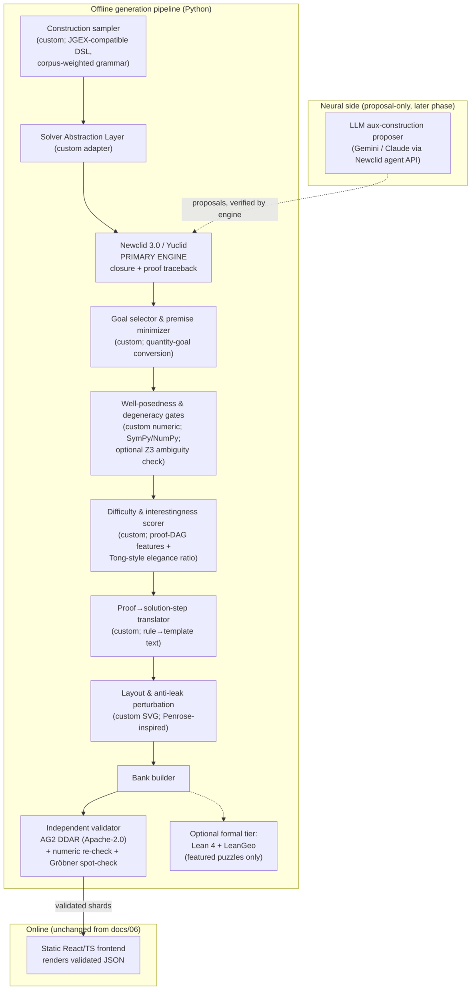

# 09 — Recommended Hybrid Architecture

## 9.1 Design answer to the seven options in the research brief

| Option | Verdict |
|---|---|
| LLMs only | **No.** No validity guarantees; every serious system rejects this |
| Symbolic only | Viable for v1 angle/quantity puzzles, but caps difficulty (no aux constructions) |
| **Neuro-symbolic (symbolic core + neural proposer)** | **Yes — the field's unanimous winning pattern** (AG1/2, Aristotle, Seed, Tong) |
| Multiple theorem provers combined | **Yes, for validation**: primary engine + uncorrelated second engine + algebraic spot-checks |
| Multiple LLMs combined | Unnecessary in v1; revisit for aux-construction proposal diversity |
| Search-based verification | Yes — numeric sampling (kept from `docs/04`) + optional SMT/Gröbner |
| Formal proof assistants for validation | Yes — optional Lean/LeanGeo tier for featured puzzles, never in the hot loop |

## 9.2 System architecture

Key properties preserved from the original spec: one-way dependency to the frontend; determinism by seed;
attrition-with-logging at every gate; numeric layer verifies, never derives; **independent validation now
uses a genuinely uncorrelated engine** (AG2 DDAR vs. Newclid) — a strict upgrade over `docs/02`
invariant 3, which could only promise separated code paths within one homegrown codebase.

## 9.3 The Solver Abstraction Layer (the pivot's central engineering artifact)

A thin interface (`solve(construction, opts) -> {facts, proof_dag, trace}`) with three planned backends:
1. **Newclid/Yuclid** (primary — pending license resolution),
2. **AG2 DDAR** (validator; also fallback primary if Newclid licensing fails),
3. stub for future engines (Seed-Geometry if released; a homegrown mini-engine is a last-resort backend,
   which keeps the learning-project option alive without betting the product on it).

Everything downstream (goals, difficulty, layout, bank) depends only on this interface. This is the
insurance policy against the ecosystem's main weakness (small-team dependencies).

## 9.4 Component-by-component recommendation

| Concern | Choice | Notes |
|---|---|---|
| Geometry theorem prover | Newclid 3.0 (+ AG2 DDAR as second opinion) | See license caveat, [07](07-open-source-ecosystem.md) |
| Reasoning/search engine | Engine-internal (DD+AR); no external search in v1 | SKEST/MCTS ideas only if aux-construction generation stalls |
| LLM | Gemini (Deep Think lineage) or Claude, via API, proposal/prose roles only | Contract in [04 §4.5](04-neural-reasoning.md) |
| Symbolic/CAS | SymPy (BSD) in validation layer | Replaces "no CAS until v1.5" — adopt now, it's free leverage |
| Diagram generation | Custom SVG layouter per `docs/06` | Penrose = reference architecture; GeoGebra Discovery = authoring/debug cockpit |
| Verification framework | Numeric sampling gates (custom) + AG2 cross-derivation + optional Z3/Gröbner + optional LeanGeo | Four independent legs, priced per tier |
| Construction DSL | JGEX-compatible surface syntax | Interop with AG/Newclid/benchmarks for free |
| Difficulty | Custom DAG scoring (`docs/05`) + Tong elegance ratio + FGeo-Eval-style completion metrics | Still no off-the-shelf option |
| Bank/frontend | Unchanged from `docs/02`/`06` | Engine swap invisible behind JSON contract |

## 9.5 What changes in the existing docs/

- `docs/03-core-engine.md`: **superseded** — replace rule-DB/deduction internals with the Solver
  Abstraction Layer spec + engine adapter contracts. The facts/DSL sections become the adapter's data
  model. The undirected-angle/side-condition design (and its known flaws) becomes the *translator's*
  problem, not the engine's.
- `docs/04`: stages survive; Stage 4 becomes an engine call; Stage 7 keeps the configuration-fact fix
  from the earlier review. Attrition logging unchanged.
- `docs/05`, `docs/06`: survive nearly intact; add elegance-ratio to §5.3.
- `docs/07`: add new recorded decisions — R3 (don't reuse existing provers) is **explicitly reversed** with
  rationale (AG2 open-sourcing, Newclid maturity); record the Newclid-license contingency and the GPL
  boundary policy.
- `docs/09`: replaced by [10-roadmap-and-risks.md](10-roadmap-and-risks.md).

## 9.6 Path to the universal-mathematics vision

Geometry first (symbolic engines are uniquely strong there). Each later domain follows the same shape:
**a domain oracle that can generate-and-verify + a difficulty model + the same bank/product layer.**
- Algebra/inequalities, number theory, combinatorics: Lean 4 + mathlib as verifier; open RL provers
  (Kimina / DeepSeek-Prover-V2 / Goedel-V2) as solvers; generation via templated construction + CAS
  verification (SymPy) for the easier bands, prover-verified for hard bands.
- Calculus/linear algebra: CAS-verified generation (SymPy) is largely sufficient; formal tier optional.
- The bank schema, difficulty framework, hint UX, and validation philosophy are domain-agnostic — that
  product spine, not any single engine, is the platform.
